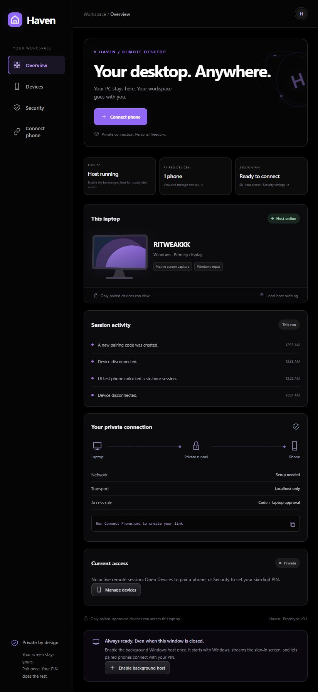
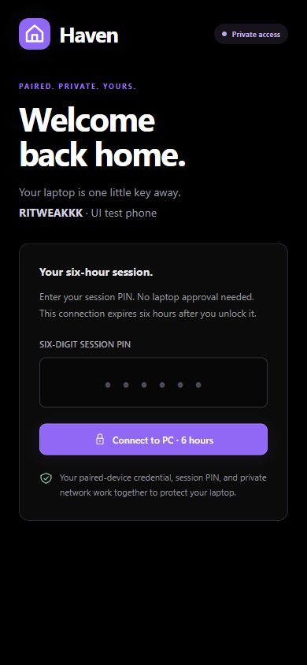
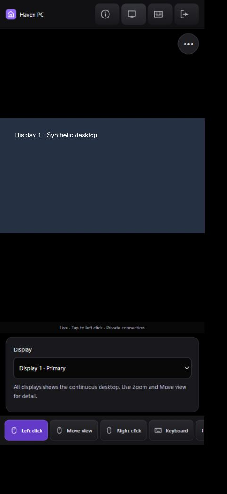

# Haven

**Your desktop. Anywhere.** A Windows background host, an Android APK, and an iPhone Home Screen web app for your own devices. Solid black, purple accents, and metallic grey controls. No RealVNC subscription or paid remote-desktop SDK.

[Download Windows / Android](https://github.com/ritwik1612/haven-remote-desktop/releases/latest) · [Source](https://github.com/ritwik1612/haven-remote-desktop) · [MIT license](LICENSE)

 

Interface previews from isolated browser checks; test devices are not live remote sessions.

## The connection flow

1. Set up Windows once and **choose your own six-digit session PIN**.
2. Pair your phone using a **different, generated onboarding code**, then approve the first request on the PC.
3. Later, enter your chosen PIN on that paired phone. Access lasts **six hours**; no new PC approval is needed.
4. When the session expires, enter the PIN again. Closing the Windows dashboard does not stop an installed background host.

Onboarding codes expire after two minutes and are used once. Your chosen PIN remains valid until you change it. A PIN alone is insufficient: the phone also needs its saved pairing credential and private Tailscale access.

## Windows setup

Requires Windows 10/11 x64, Microsoft Edge WebView2 Runtime, internet, and a personal Tailscale account. WebView2 is normally already present on modern Windows. Node and Python are bundled in the EXE.

1. Install [Tailscale for Windows](https://tailscale.com/download), sign in, and connect it. Install Tailscale on your phone using the same account.
2. Download and open **Haven-Windows.exe** from [Releases](https://github.com/ritwik1612/haven-remote-desktop/releases/latest).
3. Haven sets up private HTTPS with Tailscale Serve. If Tailscale asks you to enable HTTPS/Serve, follow its account setup link and reopen Haven. No public Funnel or router port forwarding is used.
4. Click **Enable background host** and approve Windows' administrator/UAC setup. This installs Haven Remote Host and the GPL TightVNC 2.x service for automatic startup, with VNC restricted to loopback.
5. Wait for setup, then reopen Haven if the dashboard has not returned automatically.
6. Open **Security → Set session PIN**. Choose six digits, confirm them, and save. Haven stores a salted hash, not the PIN itself.
7. Open **Connect phone** and follow Android or iPhone instructions below. Approve the first request under **Devices**.

Opening the packaged desktop app installs its GUI under your user profile and creates Start menu/Desktop shortcuts. The privileged background components remain under Program Files. This PC's installed host has been verified running; no restart or lock-screen test is performed automatically.

### Notification-area logo

Haven adds its purple logo to the Windows notification area/hidden-icons panel. It remains when the dashboard is closed and starts again at your next Windows login. Click it to open Haven; right-click for host status and **End current remote session**. **Exit tray icon** hides the icon but deliberately leaves the background service available. Windows controls whether an icon is in the overflow panel or pinned next to the clock.

The tray is a separate .NET Framework notification process. It does not keep a WebView or capture loop alive and does not continuously poll the host. It reuses Windows' framework rather than bundling a Python runtime.

After setup the PC must remain **on, awake, and online**. Haven cannot answer while the PC is off or asleep. The Haven PIN authorizes a connection; it is separate from the Windows password. If Windows is locked, use its normal sign-in screen inside the remote desktop. The background service is required for that screen; the development capture preview cannot control it.

The Haven EXE is an **unsigned development build**. Windows may show a publisher/reputation warning. Do not disable antivirus or certificate verification. The bundled TightVNC MSI is the official signed GPL installer.

| Windows navigation | Purpose |
| --- | --- |
| Overview | PC status, paired-device count, connection details, activity |
| Devices | Every phone paired with this PC, approval requests, current session/connection state, disconnect and forget controls |
| Security | Set/change your own PIN and inspect protections |
| Connect phone | Android/iPhone onboarding, private link, QR code, temporary code |

Multiple phones can be paired; this prototype allows **one active remote session at a time**. A new PIN session replaces the previous session. End the current session before pairing another phone. **End session** stops current access. **Forget** removes permission to return. Changing the PIN ends the session without forgetting devices.

## Android APK

Requires Android 8+ and an updated Android System WebView/Chrome.

1. Install Tailscale from Google Play. Use the PC's account and connect the VPN.
2. Download **Haven-Android.apk** from [Releases](https://github.com/ritwik1612/haven-remote-desktop/releases/latest). Review Android's sideload prompt and install if you trust this build.
3. Open Haven and enter the PC's private HTTPS `.ts.net` link, including `:8443` when shown. Tap **Connect to PC**.
4. Enter the PC's generated onboarding code, name the phone, and tap **Connect to PC**.
5. Open **Devices** on Windows and approve control or view-only access.
6. On later visits, enter your chosen six-digit PIN for six-hour access.

The APK stores the laptop address and same-origin browser cookies privately. It does not save the PIN, add a JavaScript-to-Android bridge, accept HTTP, or bypass TLS errors. It requests only internet permission.

## iPhone / iPad with Safari

No App Store fee, Apple developer membership, or IPA signing is needed.

1. Install Tailscale from the App Store. Use the PC's account and turn on the VPN.
2. Open the PC's private Haven link in **Safari**; scan its QR code or enter the URL.
3. Tap **Share → Add to Home Screen**. Keep **Open as Web App** enabled if offered. The icon is called **Haven**.
4. Launch that Home Screen app **before pairing**. Safari and an installed web app may have different cookie storage.
5. Enter the PC's temporary onboarding code and tap **Connect to PC**. Approve once under **Devices** on Windows.
6. Later, enter your own session PIN. Haven opens in its own window without Safari's normal address bar.

iOS may suspend networking in the background. Reopen Haven to resume an unexpired session, or enter the PIN to start another one. Removing app/website data or forgetting the device requires pairing again.

### Optional Vercel setup page

The [iPhone setup page](https://haven-ios.vercel.app) is live on Vercel. Its source is in `ios/`. It opens your private PC link and explains Home Screen installation. **It never accepts a PIN or relays desktop traffic.** A laptop address supplied in `#host=...` stays in the URL fragment, which is not sent to Vercel by normal HTTP navigation.

Install the actual Home Screen app **from your private PC page**, not the public setup page. Vercel is optional: use the private link directly. The setup deployment is static and runs no remote-desktop server or Vercel Functions.

## Phone controls

- **Keyboard** opens typing, modifiers, special keys, letters/numbers, arrows, and F1–F12.
- For **Win+L**, tap **Win**, then **L**. Haven sends both keys down together and releases them in reverse order. Simultaneous finger presses are unnecessary.
- For **Ctrl+Shift+Esc**, tap Ctrl, Shift, then Esc. Selected modifiers highlight and clear after the shortcut.
- One-tap shortcuts include Start, Alt+Tab, Win+D, Lock laptop, and Task Manager.
- **Right click** uses the current VNC pointer location. **Pan** moves a zoomed viewport. **Zoom** toggles fitting the desktop to the screen.
- **Disconnect** ends access but preserves pairing, so your PIN can reconnect.

VNC handles touch/drag gestures. The source capture preview has simpler controls. Audio, file transfer, clipboard synchronization, and wake-on-LAN are not implemented. Secure attention, protected apps, policy restrictions, and some Windows sign-in configurations may need additional integration; this is not a promise of RealVNC feature parity.

## Network, speed and idle resources

```text
Phone <-- encrypted Tailscale path --> Windows PC
                                         |
                                    HTTPS / Haven
                                         |
                                  loopback-only VNC

Vercel = setup page only; no screen, input, PIN checks or relay.
```

Tailscale tries a direct encrypted device connection. NAT/firewalls may force its encrypted relay instead; that path also does not use Vercel. The PC is the desktop server in both cases.

The installed host uses changed-region VNC updates, a persistent WebSocket, low compression CPU settings, explicit TCP no-delay, a 60 ms polling fallback, and a single roughly 184 KB client bundle. Actual latency depends on network signal, distance, direct/relay routing, screen activity, and the PC. No zero-latency or frame-rate guarantee is made.

Close the dashboard when unused; its WebView and animations are separate from the service. An idle VNC host does not start the Python capture helper. The capture-preview helper exits after 30 seconds without work. The wrapper uses installed .NET Framework. Node's JavaScript heap is capped at 96 MB in service mode; this is **not** a cap on total RAM.

The installed host measured about **95 MB combined idle working set** on the development PC: Node 56 MB, the service wrapper 26 MB, and TightVNC 13 MB. The notification icon added about 35 MB, bringing host + tray to roughly **130 MB**, excluding Tailscale and an open dashboard. Working sets include shared pages and can change during/after a session; these are measurements, not guaranteed limits.

## Access protections

- Random, single-use two-minute onboarding codes plus local approval. Device labels are user supplied, not verified hardware identities.
- Salted `scrypt` PIN hashes and hashes of random 256-bit paired-device credentials. No PINs or browser tokens in activity logs.
- Five incorrect PINs cause a fifteen-minute Haven lockout. Pairing guesses have a separate five-attempt / one-minute limit.
- HttpOnly, SameSite=Strict, Secure cookies on the private HTTPS origin. Same-origin JSON required for changes; no cross-origin API access.
- Six-hour hard expiry. Host restarts end sessions but retain pairing/PIN data.
- VNC on `127.0.0.1:5908`; Haven on `127.0.0.1:4318`; private Tailscale HTTPS on 8443. Service executables live under Program Files; state/secrets under ProgramData with restricted ACLs.
- A separate VNC view-only password enforces viewing permission beyond a UI toggle.
- Screens are not recorded. The service worker caches public appearance assets and a reconnect page, not APIs, frames or credentials.

Protect your Tailscale account and Windows login. Local administrators/malware are outside this boundary. This is a development prototype, **not a security-audited production product**.

## Cost and licenses

Haven's original source is **MIT licensed** with no subscription, activation, expiry, paid SDK, or AI API. Third-party free software retains its licenses; see [notices](THIRD_PARTY_NOTICES.md) and `licenses/`. The unmodified TightVNC corresponding source accompanies its bundled GPL installer in the release.

The setup is intended for current personal/free Tailscale, GitHub and optional Vercel offerings. Their future prices, terms, quotas, and availability are outside Haven's control; an honest lifetime guarantee cannot be made for another company's service. Internet/data and electricity costs remain. Vercel can be skipped completely.

## Build and check

Use Windows, Node.js 22+, and Python 3.10+:

```powershell
npm ci
python -m pip install -r requirements-build.txt
npm run build:client
npm test
```

Source capture preview: run **Connect Phone.cmd** once, then **Start Haven.cmd**. Packaged background setup is performed from Haven-Windows.exe.

```powershell
python scripts/setup-android-tools.py
python scripts/build-android.py
python scripts/build-windows.py
```

The Android tools/JDK come from official sources and build locally, with no cloud build fee. Keep ignored `.build/signing/` private and back it up to sign compatible future APK updates. Never commit signing keys. Release binaries are in ignored `downloads/` and uploaded as GitHub assets.

### Verification and limits

- Automated checks cover unauthorized frames/input, pending approval, view-only access, revocation, expiry/reuse, brute-force limits, origin/host protection, Secure cookies, validation, six-hour timing, PIN/device access, forgetting devices, combined keys, and PWA assets.
- Android compiled for API 35 / minimum API 26; APK v2/v3 signatures and manifest inspection passed. Physical Android installation has not been verified.
- Windows bundle checks include assets, Node syntax, WebView import and packaged native capture. Release checks are rerun after final packaging.
- The official TightVNC MSI signature was verified. Real RFB 3.8 password authentication and read-only 2880 × 1800 framebuffer delivery passed. This check sends no real mouse/keyboard input.
- Browser checks cover desktop/390px phone layouts, PIN mismatch, onboarding/approval, device navigation, modifier highlighting, Win+L and Ctrl+Shift+Esc against a mock host, disconnect, and PIN-only reconnect.
- Installed host: both services run with Automatic startup. The installed VNC service passed view-only authentication and real screen delivery at 2880 × 1800. A live noVNC browser connection also rendered the full desktop with input disabled.
- Reboot/locked-screen tests and physical iPhone/Android tests have not been performed. Browser viewport testing does not substitute for Safari/WebView hardware testing. Release notes record final hashes and remaining limits.

## Stop or remove

Use **Devices → End current session** to stop access, or **Forget** to remove a phone. Closing the app leaves the installed host running.

Windows Services can stop **Haven Remote Host** and **TightVNC Server**. Remove TightVNC through Installed Apps. An administrator can uninstall Haven's wrapper with `"C:\Program Files\Haven\HavenService.exe" uninstall`. Remove only Haven's private route with `tailscale serve --https=8443 off`; do not reset unrelated Tailscale services.


## Mobile session controls



The compact toolbar provides Info, Displays, Keyboard, and Disconnect. Tap the floating **•••** button to hide or reveal the toolbar. Haven keeps its own branding while following familiar remote-viewer control conventions.

- **Left click** (default): tap once to click; hold and move to drag windows or select text.
- **Right click**: opens the context menu at the last pointer location.
- **Move view** means **pan**: move the zoomed desktop around without sending a mouse click. **Zoom** switches between fitting the display and native pixels.
- **Keyboard** opens your phone’s normal keyboard (tap the text field if it was dismissed). Type and tap Send or Return; Unicode text and IME composition are supported. It also provides Ctrl, Alt, Shift, Win, navigation keys, F1–F12, and letter keys. Select modifiers, then a key to press the combination together. Quick shortcuts include Win+L, Alt+Tab, and Ctrl+Shift+Esc.
- **Displays** offers **All displays** as one continuous Windows desktop, or individual connected monitors. This crops the viewer without changing Windows display settings. Display metadata comes from the small tray process at login and when the screen arrangement changes; before metadata is available, All displays still works. If the layout and VNC framebuffer disagree, Haven safely uses All displays.

The iPhone setup page remembers only the laptop address in this browser. The private Home Screen app opens that PC directly. Pairing is kept in a secure browser cookie; use the same installed app after pairing. Clearing website data removes that credential and requires pairing again. If a paired PC has no PIN yet, the phone asks you to set it once in Windows Security settings instead of sending you back to onboarding. Network interruptions never intentionally forget the device.


## Scan QR pairing

Tap **Scan QR** in the phone app. On Windows, open **Connect phone** and generate a fresh pairing code/QR. Scan it: Haven fills the address and code automatically. Approve a new phone once under Windows **Devices**. A QR only pairs the phone; it never unlocks the desktop. After approval, enter your own six-digit session PIN to open a six-hour session. Saved PCs remain until you remove them or clear/uninstall the app; browsers can also evict website data. Away from the PC, the saved session PIN remains available for returning connections. A session PIN alone cannot pair an unknown device.

**Use a pairing code instead** is the secondary onboarding option. On iPhone, grant camera permission when requested and use the private Home Screen app for a consistent saved pairing. Android's updated APK requests camera access only for scanning; camera hardware is optional. QR images are decoded locally, and the camera stops on success, cancel, or leaving the scanner. The Vercel page never proxies authentication or desktop traffic. QR codes expire after two minutes, are single-use, and never contain your session PIN.
